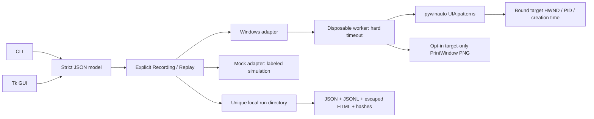

# Architecture

## Responsibilities

`model.py` validates the entire script before desktop actions; `privacy.py` applies conservative public-test-data guards. `engine.py` evaluates assertions consistently and stops on the first failure. `Recording` appends an operation only after successful execution. CLI and GUI recordings use the same evidence pipeline; low-level library callers may omit audit output explicitly.

`adapters/windows.py` freezes the window identity and starts one worker per operation. A worker timeout kills the worker, reports `WORKER_TIMEOUT_OUTCOME_UNKNOWN`, and never retries an input automatically. The target may have received the action; the user must inspect/reset their app. This bounds client waiting, not provider side effects.

`uia_worker.py` selects an optional existing private desktop before importing COM, then uses pywinauto's UIA wrappers. It finds exact control-type/AutomationId/name matches within the bound root, filters to the same PID, rejects zero/multiple matches, and checks password state before reading text. It checks window identity before and after actions. The underlying UIA protocol is provided by Windows and pywinauto.

Value/Invoke are semantic operations, not keyboard/mouse emulation. On the user's current desktop, actions require an enabled, visible control. A private desktop reports controls offscreen; there the worker additionally accepts an enabled control with a real visible HWND. It never switches desktops or injects physical input. This path was validated against the owned standard WinForms controls only.

`image.py` encodes an explicitly top-down BGRA DIB as PNG. Capture matches the target's DPI context within the disposable thread, obtains only PrintWindow pixels, skips password-containing windows, and fails if the image is blank or unavailable. No whole-screen fallback exists. A valid image is not proof that the provider redacted all private content.

`analysis.py` compares normalized outcomes/text hashes (not image pixels or timing), describes a repeated-run sample, and attempts budgeted step deletion. Reduction accepts only the original assertion's action, error code, step hash and observed-value fingerprint. The caller must reset an owned app on every attempt. A `one_minimal` result means tested single-step deletions did not preserve that signature, not that a globally shortest or semantically equivalent test was found.

## Persistence and recovery

Each replay uses a timestamp + UUID directory created exclusively. `events.jsonl` is flushed after every completed step. Normal completion writes the final JSON/HTML/manifest. If a process is killed or the disk fails, partial directories remain and cannot be presented as completed verified bundles. No failed run is deleted. File hashes detect changes relative to a trusted manifest; they are not signatures or independent attestation.

The portable script contains no HWND/PID/absolute application path. A new process/window needs a fresh explicit runtime binding. Tools under `tools/` own their fixture lifecycle and retain held process handles, so cleanup cannot terminate an arbitrary process with a reused PID. The product CLI/GUI never kills or restarts a selected user's application automatically.

## Deliberate boundaries

No coordinate fallback, global event hooks, OCR, browser extension, network server, AI API, autonomous task planner, arbitrary shell step, implicit auto-repair, or broad desktop capture. Dialogs/child processes outside the selected root/PID require a separate explicit binding; service/session-zero, locked desktop, elevated apps, custom-drawn/game surfaces and app updates remain compatibility risks.
